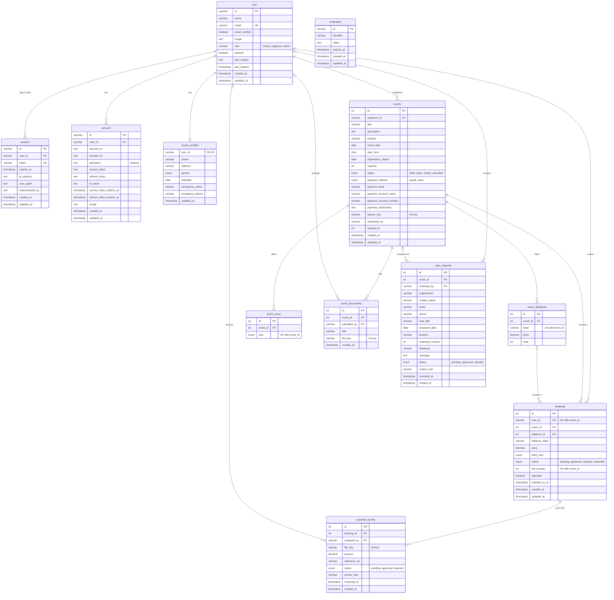

# RaceLink ERD

Database: `racelink_v2` (MySQL 8.4, Amazon RDS). Source of truth: `lib/db/schema.ts`.

## Foreign keys and delete rules

| Column | References | On delete |
| --- | --- | --- |
| `session.user_id` | `user.id` | cascade |
| `account.user_id` | `user.id` | cascade |
| `runner_profiles.user_id` | `user.id` | cascade |
| `events.organizer_id` | `user.id` | restrict |
| `bookings.user_id` | `user.id` | cascade |
| `bookings.event_id` | `events.id` | cascade |
| `bookings.distance_id` | `event_distances.id` | set null |
| `event_distances.event_id` | `events.id` | cascade |
| `event_sizes.event_id` | `events.id` | cascade |
| `event_documents.event_id` | `events.id` | cascade |
| `event_documents.uploaded_by` | `user.id` | set null |
| `payment_proofs.booking_id` | `bookings.id` | cascade |
| `payment_proofs.reviewed_by` | `user.id` | set null |
| `race_requests.reviewed_by` | `user.id` | set null |
| `race_requests.event_id` | `events.id` | set null |

## Unique rules

- `user.email` and `session.token` are unique.
- One booking per runner per race: (`bookings.user_id`, `bookings.event_id`).
- No duplicate bib in a race: (`bookings.event_id`, `bookings.bib_number`).
- No duplicate distance or shirt size in a race: (`event_id`, `label`) and (`event_id`, `size`).

## Legend

- `||--o{` one to many, `||--o|` one to zero-or-one, `|o--o{` optional one to many.
- `PK` primary key, `FK` foreign key, `UK` unique.
- `user`, `session`, `account` and `verification` are managed by Better Auth.
